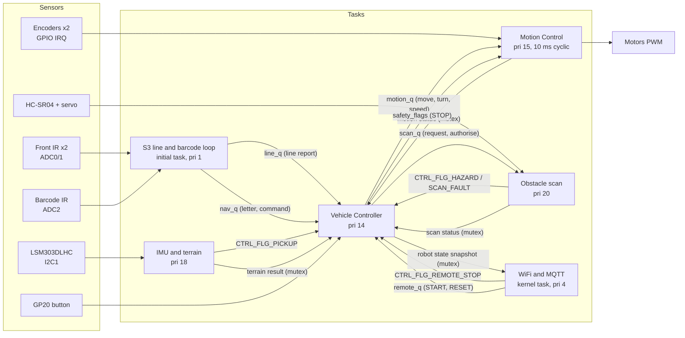
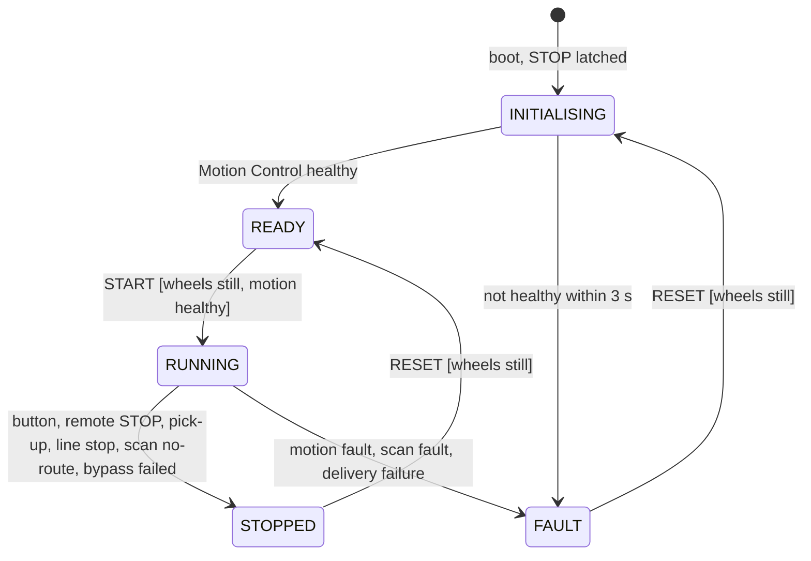
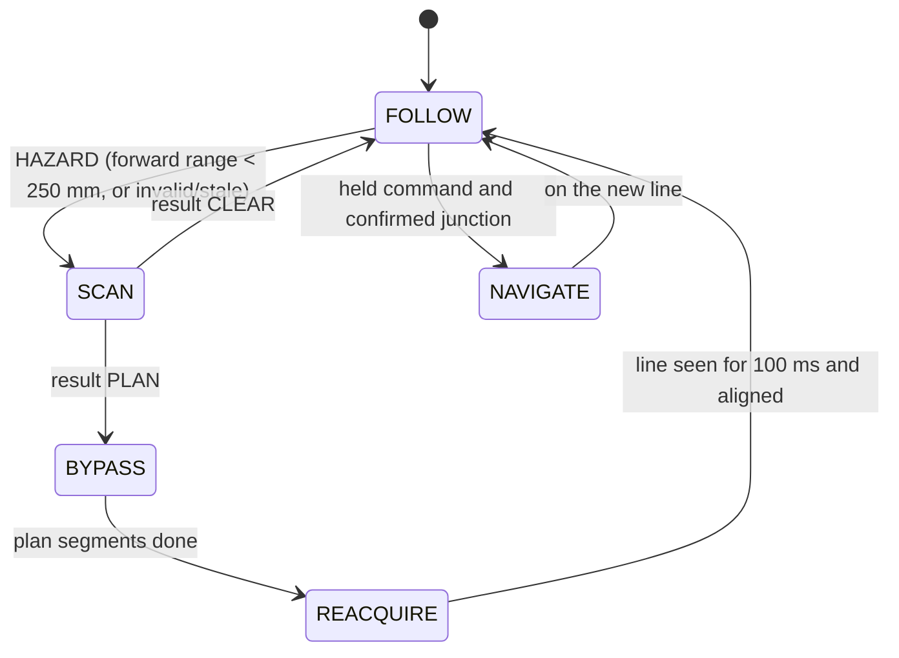
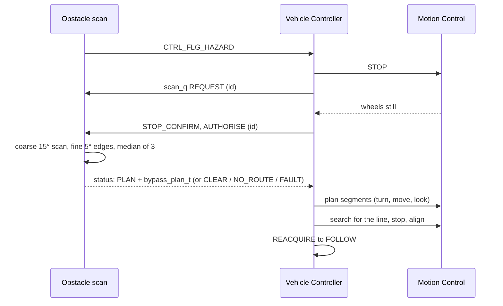

# Final architecture

This document describes the system as built and demonstrated (source
`a41c19c`, tag `demo-2026-11-24-flashed`). The original design is kept in
[AAI08_Design_Review.pdf](AAI08_Design_Review.pdf); later changes are in
[decisions.md](decisions.md) and the [tribunal closure](tribunal_closure.md).
Pins are authoritative in [AGENTS.md](../AGENTS.md); interfaces in
[TEAM.md](../TEAM.md) section 5. Where something is configured but not
measured, we say so.

## 1. Hardware

| Device | Interface | Pins (GP) | Configuration | Owner |
|---|---|---|---|---|
| Raspberry Pi Pico W (RP2040, Cortex-M0+, 133 MHz, 264 KB SRAM) on a Cytron Robo Pico | — | — | Single core since S2 d33 | — |
| 2 DC motors through the Robo Pico driver | PWM | 8/9 (left), 10/11 (right) | 20 kHz, brake at start (`drv_motor.c`) | Motion Control only |
| 2 wheel encoders | GPIO interrupts | 16/17 (left), 0/1 (right) | ×2 decoding on channel A, 1330 counts per wheel revolution, 0.16 mm per count (`motion_config.h`) | Motion Control |
| 2 front IR line sensors (analogue output, comparator output unused) | ADC0, ADC1 | 26, 27 | 12-bit ADC (0..4095), 3-sample filter, adaptive white baseline (`s3_ir.c`) | Line sensor loop (S3) |
| Side IR barcode sensor | ADC2 | 28 | Same ADC; battery-sense jumper open | S3 |
| GY-511 (LSM303DLHC accelerometer and magnetometer) | I2C1 | 2/3 | 100 Hz, ±2 g, high resolution, block data update, 1 mg per count (`drv_lsm303dlhc.c`); magnetometer not used | S4 |
| HC-SR04 ultrasonic sensor | GPIO | 4 (TRIG), 5 (ECHO) | Powered from 3V3 (S5 d13); ≥ 65 ms between triggers | S5 |
| SG90 servo | PWM | 12 | 50 Hz frame, 1 µs steps, centre 1400 µs, 10 µs per degree, ±45° (`drv_servo.c`) | S5 |
| GP20 button | GPIO, active low | 20 | 30 ms debounce | Vehicle Controller |
| CYW43 WiFi | Internal SPI | 23–25, 29 | Reserved | Kernel WiFi task |

The right encoder uses GP0/GP1, which UART0 would take, so the build
refuses `CRASH_REPORT=1` and a UART console; the console is USB.

## 2. Software structure



**Rules that hold across the system** (checked in the
[software review](software_quality_review.md)):

- Only the Vehicle Controller decides movement and recovery. Only Motion
  Control writes motor PWM.
- STOP is latched; only RESET then START clears it. Urgent stops travel on
  kernel event flags, never behind a queue.
- The car stops before scanning: Obstacle Scan may move the servo only
  after Motion Control confirms both wheels are still.
- Network code stays in the kernel WiFi task and `subsystem1/`; losing
  WiFi never stops or starts the car.
- Every exchange between tasks is non-blocking (`TMO_POL`) or has a bounded
  wait, so no control loop can hang on another task.

## 3. RTOS tasks

µT-Kernel 3.0, single core, kernel tick 10 ms (`CNF_TIMER_PERIOD`). Lower
number means higher priority.

| Task | Priority | Wake-up | Configured period | Measured | Inputs → outputs | Shared resources |
|---|---|---|---|---|---|---|
| Initial task: S3 line and barcode loop (`s3_follow_run()`) | 1 | `tk_dly_tsk(10)` | 10 ms | **20 ms** (953 bar durations, all 20 ms multiples) | ADC0–2 → `line_q`, `nav_q` | Letter table (single bytes) |
| USB console | 3 | Kernel | — | — | `tm_printf` | — |
| WiFi, MQTT, S1 bridge | 4 | Kernel, link events | Telemetry 1 s, heartbeat 5 s | 98.6% of frames received (demo) | robot-state snapshot → MQTT; MQTT → `remote_q`, STOP flag | `state_mutex` (`TMO_POL`) |
| Vehicle Controller (`controller_task`) | 14 | `controller_flags` wait, at most 10 ms | 10 ms | Not measured | Flags, queues, status snapshots → `motion_q`, `scan_q`, robot state | `state_mutex` (owner) |
| Motion Control (`motion_task`) | 15 | 10 ms cyclic handler | 10 ms | STOP latch to PWM off: worst 952 µs (S2-H11) | `motion_q`, `safety_flags`, encoders → PWM, motion status | `g_status_mtx` (owner) |
| IMU and terrain (`s4_imu_task`) | 18 | `tk_dly_tsk` | 10 ms poll | About 21 ms per sample (S4 d12 note) | I2C samples → terrain result, `CTRL_FLG_PICKUP` | S4 mutex (owner) |
| Obstacle scan (`obstacle_scan_task`) | 20 | Bounded waits | Trigger ≥ 65 ms apart | Scan takes about 4 to 6 s (demo log, SCAN to result) | ECHO ring, `scan_q` → HAZARD flag, scan status | S5 mutex (owner) |

**Why these priorities.** The S3 loop runs in the kernel's initial task
(priority 1), so its sampling is as regular as the tick allows; its sample
times come from the hardware timer, so a late wake-up does not distort a
measured bar duration. The controller sits above Motion Control so a STOP
decision is made before the next motion step. The IMU and scan tasks are
lower because their deadlines are longer (21 ms samples, 65 ms triggers).

**Priority inversion and deadlock.** All four mutexes use `TA_INHERIT`.
No task takes two mutexes at once (`robot_state.c` reads each provider in
turn), so there is no lock-order deadlock. Readers use `TMO_POL` and mark
the data invalid for that cycle if the lock is busy.

**Single core.** The dual-core build lost task wake-ups on 2026-11-23
(S2 d33): the S3 loop or the IMU task stopped while others kept running.
The mission has run on one core since. About 100 minutes of demo-day logs
show no line-loop stall. The kernel defect itself was not found.

**What is not measured.** Worst-case execution time of each task, and
control-loop jitter under combined WiFi, encoder and echo load. We do not
claim deadlines are guaranteed; S2-H11 measures only STOP latch to PWM
off.

## 4. Vehicle Controller state machine

Implemented in `controller_logic.c` (pure, host-tested by S2-U41 to U52,
U78); run by `controller_task()`.



START in any state other than READY is rejected, and so is a remote
command older than 2 s or with a repeated request ID (`ctrl_remote()`,
S2-U50).

Inside RUNNING the controller has a mode, sent in telemetry:



A NO_ROUTE or FAULT scan result, a failed bypass or reacquisition, and a
failed junction manoeuvre all leave RUNNING through a latched STOP. A GP20
press sends RESET and then START once the car is READY.

## 5. Main sequences

### Barcode to turn

```mermaid
sequenceDiagram
  participant S3 as S3 loop
  participant C as Vehicle Controller
  participant M as Motion Control
  S3->>S3: capture runs; decode Code 39 (s3_scan_poll)
  S3->>C: nav_q {letter, command}
  C->>C: nav_receive: validate, hold command (60 s)
  S3->>C: line_q: BOTH_BLACK reports
  C->>C: line_control: 100 ms of BOTH_BLACK = junction
  C->>M: STOP, then MOVE (axle onto junction)
  C->>M: TURN (spin until the line is seen)
  M-->>C: DONE / FAULT
  C->>C: SETTLE, then FOLLOW
```

### Obstacle to bypass and line recovery



### Hump to telemetry

```mermaid
sequenceDiagram
  participant I as IMU task
  participant C as Vehicle Controller
  participant W as WiFi task
  I->>I: 100 Hz samples; tilt average; height from contact geometry
  I->>I: rise >= 6 mm, then level < 2 mm: hump complete, round to mm
  I->>I: update last, maximum, count (mutex)
  W->>C: robot_read_telemetry (each provider under its own mutex)
  W->>W: encode 31-byte frame; publish every 1 s
```

## 6. Sensors: accuracy and limits

| Sensor | Principle | Resolution / range | Calibration | Main error sources | Mitigation in software | Evidence |
|---|---|---|---|---|---|---|
| Front IR | Reflected infrared; black absorbs | 12-bit ADC; white about 100–300, black about 1,500–3,300 | Adaptive white baseline with fixed black and white margins (hysteresis) | Height and angle to the floor, ambient light, faded tape | Baseline tracks slow change; 3-sample filter; strength-based steering | S3-H01, H02; SYS-01 |
| Barcode IR | As above, side-mounted | Bar timing resolution **20 ms** (0.8 mm at 40 mm/s) | White 154–184 measured at the old height; margins 400/300 | Spot size against small bars, height, wrinkled paper, speed change over the code | Midpoint split per capture; one-element correction; reject rather than guess | S3-U02; demo report D-01 |
| Encoders | Quadrature pulses from the motor encoders (type not recorded) | 0.16 mm per count | Effective circumference 217.6 mm on the course floor (S2 d31) | Wheel slip, floor surface (±4% between floors) | Sequence-locked snapshots; invalid-snapshot and stall faults | S2-H07, H10 |
| LSM303DLHC | MEMS accelerometer | 1 mg per count, ±2 g, 100 Hz | 50 still samples, spread ≤ 80 mg | Acceleration read as tilt, vibration, no gyroscope | Pitch ignored while speed changes; 16-sample average; 6 mm rise; scale 0.851 | S4-H07, H08; S4-U41 |
| HC-SR04 | 40 kHz echo time of flight | 20 mm to 4 m; 1 mm from integer maths | 3V3 supply; 0.5 s power-up allowance | Wide beam (about 21° effective half-angle, S2 d18), angled surfaces, missing echoes | Median of 3 per angle; beam allowance on edges; invalid/stale count as unsafe | SYS-05; S2 d18 |
| SG90 servo | PWM position | 1 µs steps, 10 µs per degree | Centre 1400 µs (provisional mapping) | Centre offset, settling time | Settling delay before each trigger (S5-U16) | S5-U47 |

**Sensor fusion.** We do not run a formal fusion filter. Sensors are used
together where one checks another: wheel speed from the encoders tells the
IMU logic when pitch is unreliable (acceleration); encoder travel tells the
junction step how far the axle has rolled since both sensors went black;
the line sensors confirm the end of a bypass that the encoders drove. A
complementary filter would need a gyroscope, which the GY-511 does not
have.

## 7. Timers, ADC and PWM

| Item | Setting | Why |
|---|---|---|
| System timer | 1 MHz free-running (`TIMERAWL`), set by the kernel (S2 d7) | µs timestamps for encoder and echo edges and bar durations |
| Kernel tick | 10 ms | Sets the granularity of every `tk_dly_tsk` (the cause of F-01) |
| Motion period | 10 ms cyclic handler | Exact period for the PID |
| Motor PWM | 20 kHz | Above hearing; full 0..max duty range |
| Servo PWM | 50 Hz, 1 µs | Standard hobby-servo frame |
| ADC | 12-bit, channels 0–2 only; ADC3 (GP29) left for the radio | Three IR sensors |
| Ultrasonic | ≥ 65 ms between triggers; 30 ms echo limit (beyond 4 m) | Datasheet recommends ≥ 60 ms; no echo overlap |

## 8. Resource efficiency (W10)

| Resource | Measured | Design choice |
|---|---|---|
| Flash | Application 48,024 bytes of 374,410 in the image (12.8%) | `-O2`, `-ffunction-sections -fdata-sections` with `-Wl,--gc-sections` (unused code removed) |
| Static RAM | Application 2,017 bytes; whole image 80,120 bytes (30% of 264 KB) | Fixed buffers; the application never calls `malloc` or `free` |
| Stacks | 4 × 2,048 bytes for application tasks; initial task 4,096 | Sized for `tm_printf` and the barcode decoder's 1.3 KB copy |
| Processing | No floating point; integer and fixed-point units (µm, mg, mdeg, per mille); a sine table for scan geometry | The Cortex-M0+ has no FPU |
| Communication | 31-byte binary frame per second (about 248 bit/s); commands as short text | Compact, versioned, decoded by the dashboard |
| Power | Not measured. Tasks block between periods; WiFi power save is off by choice (S1 d4) to keep latency low | — |

Details and the bit-level analysis are in [data_widths.md](data_widths.md).

## 9. Edge computing (W11)

All sensing, decisions and safety responses run on the Pico. The laptop
only receives telemetry and sends START, STOP, RESET and the barcode letter
table.

| Benefit | How it shows in this car |
|---|---|
| Autonomy | Line following, barcode decoding, hump measurement, obstacle scanning and bypass planning all run locally |
| No dependence on the network | The car kept following for over 4 minutes with the link lost (SYS-01, 2026-11-20) |
| Low latency for safety | STOP from a local source reaches the motors in under 1 ms (S2-H11); a network round trip would add an unbounded delay |
| Low bandwidth | Raw data (ADC samples at 50 Hz × 3, IMU at 100 Hz, 19-angle scans) stays on the car; only a 31-byte summary per second leaves it |
| Safe degradation | Losing WiFi clears the `link up` flag and nothing else (Tribunal 2 Entry 20) |

## 10. Changes from the design review

| Design review (Week 6) | Final | Reason |
|---|---|---|
| Three digital IR sensors with edge interrupts | Two analogue front sensors plus one analogue barcode sensor, polled | Adaptive thresholds needed analogue values (S3 d3); interrupt edges were not adopted |
| One `sensor_q` for all readings and events | Separate queues per purpose (`line_q`, `nav_q`, `scan_q`, `remote_q`, `motion_q`) and snapshots under mutexes | Tribunal 1: continuous readings and events should not share a queue |
| Remote STOP through `remote_q` | Event flag `CTRL_FLG_REMOTE_STOP` | Tribunal 1: a full queue must not delay STOP |
| Hump height from tilt and encoder distance | Tilt and contact geometry, scaled to a measured hump (S4 d8, d12) | Distance-based height drifted |
| Dual core | Single core (S2 d33) | Lost task wake-ups on two cores |
